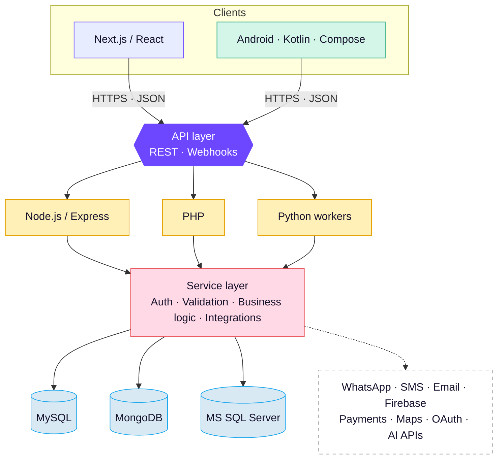
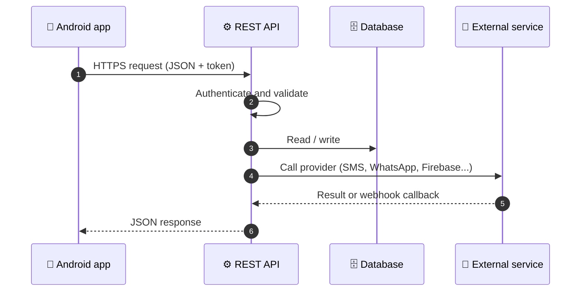
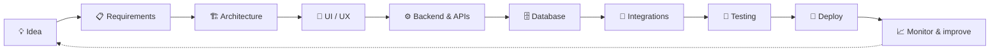
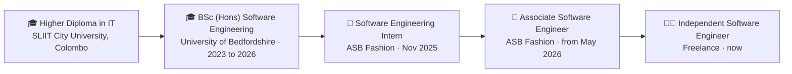

<div align="center">


<a href="https://github.com/kavizzz03">
  
</a>

<br/>

[](https://github.com/kavizzz03)
[](https://linkedin.com/in/kavindu-bogahawatte-7b3810320)
[](mailto:kavindumalshan2003@gmail.com)
[](https://wa.me/94740890730)


</div>

---

## 👋 Hello, I'm Kavindu

I'm a software engineer in **Colombo, Sri Lanka**. I build the quiet, dependable systems behind everyday things: the message that reaches a customer's phone, the order that gets approved, the app that simply works.

```ts
const kavindu: Engineer = {
  role:      "Independent Software Engineer (freelance)",
  previously:"Associate Software Engineer, ASB Fashion (Pvt) Ltd",
  education: "BSc (Hons) Software Engineering, University of Bedfordshire",
  strengths: ["REST APIs", "Backend systems", "Native Android", "Database design"],
  exploring: ["Reliable APIs", "Jetpack Compose", "WhatsApp automation", "Flood prediction"],
  openTo:    ["Freelance projects", "Long-term contracts", "Full-time roles"],
  motto:     "Build • Integrate • Scale • Improve",
};
```

<div align="center">

| 🏢 Platform I built | 🎯 Designed to scale to | 🧪 Side projects | 🧰 Stacks I ship in |
|:---:|:---:|:---:|:---:|
| **200,000+**<br/>loyalty customers | **1,000,000**<br/>customers | **30+**<br/>and counting | **6**<br/>PHP to Kotlin |

</div>

---

## 🧰 Tech Stack

<div align="center">

| | Technologies |
|:--|:--|
| **🌐 Frontend** |  |
| **⚙️ Backend** |  |
| **📱 Mobile** |  |
| **🗄️ Databases** |  **+ Microsoft SQL Server** |
| **🐳 DevOps & Tools** |  |

</div>

<details>
<summary><b>📋 Full capability matrix</b></summary>
<br/>

| Area | Focus |
|---|---|
| 🌐 **Web engineering** | Next.js, React, TypeScript, JavaScript, responsive UI, SEO |
| ⚙️ **Backend engineering** | Node.js, Express.js, PHP, Python, REST APIs |
| 📱 **Mobile engineering** | Kotlin, Java, Android SDK, Jetpack Compose |
| 🗄️ **Databases** | MySQL, Microsoft SQL Server, MongoDB, Firebase |
| 🔌 **API engineering** | REST, webhooks, OAuth, JSON, third-party integrations |
| ☁️ **Cloud & services** | Firebase, Vercel, Linux-based environments |
| 🧪 **Testing** | Postman, API testing, debugging, integration testing |
| 🤖 **Automation** | Python automation, FFmpeg media processing, background workflows |

</details>

---

## 🧩 Featured Projects

<table>
<tr>
<td width="50%" valign="top">

### 📣 Broadcast Management System
*ASB Fashion, 2026*

SMS, WhatsApp and email campaigns for **200,000+ loyalty customers**, built to keep working past 1 million.


</td>
<td width="50%" valign="top">

### 🌊 FloodMind
*BSc research project, University of Bedfordshire*

Early flood warning for the **Kelani River**: XGBoost models predict water level and flood risk from sensor data.


</td>
</tr>
<tr>
<td width="50%" valign="top">

### 🧾 Purchasing Order Management
*ASB Fashion, 2026*

Purchase orders from request to approval, goods receiving and quality check. Built with **no JavaScript framework**.


</td>
<td width="50%" valign="top">

### 🛍️ ASB Fashion Website
*ASB Fashion, 2026*

Product showcases, promotions and **online gift vouchers** for a leading Sri Lankan fashion retailer, built for SEO and speed.


</td>
</tr>
<tr>
<td width="50%" valign="top">

### 🧠 Brainana
*Personal project*

A maths and logic puzzle game for Android with a modern **Jetpack Compose** interface.


</td>
<td width="50%" valign="top">

### 🍽️ Arrow Food
*Personal project*

A backend-focused application covering clean **REST API design** and server-side logic.


</td>
</tr>
</table>

<details>
<summary><b>🧪 More from the sketchbook</b></summary>
<br/>

| Project | What it does | Stack |
|---|---|---|
| **DownVid** | A video downloader | React, Node.js, Express, Python, yt-dlp, FFmpeg |
| **AI Subtitle Pro** | Subtitles from audio and video with Whisper AI | Python, Whisper AI, Node.js, React |
| **Hire Us** | Worker registration, ID verification and job tracking | PHP, MySQL, Java |
| **KMD Sweet House** | Business site with product showcases and admin tools | React, PHP, MySQL |
| **StatusBox** | Android app for handling and saving status media | Java, Kotlin, Android SDK |
| **MediCare** | Desktop app for patients, appointments and medicines | Java, OOP, MySQL, SMTP |

</details>

> 📂 Browse everything in **[Repositories](https://github.com/kavizzz03?tab=repositories)**.

---

## 🏗️ Architecture Approach

I prefer modular systems where the **frontend, backend, database and external services stay independently maintainable**.



### 📱 Mobile ↔ API

Android clients stay lightweight while sensitive logic and data operations live behind secure backend services.



> **Integration principle:** external services are isolated providers behind reusable service layers, so they are easier to test, replace, scale and maintain.

<details>
<summary><b>🔌 API &amp; integration capabilities</b></summary>
<br/>

<table>
<tr>
<td valign="top" width="50%">

**API engineering**
- REST API development and consumption
- API keys, OAuth and bearer-token authentication
- Webhook development and verification
- Request validation, pagination and filtering
- Multipart uploads and file APIs
- Rate-limit aware calls, retries and error handling
- Background processing, logging and monitoring
- Postman collections and endpoint testing

</td>
<td valign="top" width="50%">

**Services I integrate**
- 💬 WhatsApp Business APIs
- 📱 SMS gateways
- 📧 Email services
- 🔐 OAuth and social sign-in
- 💳 Payment gateways
- 🗺️ Maps and location
- 🔔 Push notifications and Firebase
- 🤖 AI and ML APIs, 🎥 media processing

</td>
</tr>
</table>

</details>

---

## 🔐 Engineering Principles

<table>
<tr>
<td align="center" width="25%">

### 🛡️ Security
Input validation<br/>Authentication<br/>Authorization<br/>Secrets in environments<br/>Server-side checks

</td>
<td align="center" width="25%">

### ⚡ Performance
Efficient queries<br/>API optimisation<br/>Async processing<br/>Caching<br/>Background jobs

</td>
<td align="center" width="25%">

### 🧱 Reliability
Structured errors<br/>API retries<br/>Logging<br/>Webhook verification<br/>Graceful failure

</td>
<td align="center" width="25%">

### 🧩 Maintainability
Modular design<br/>Reusable services<br/>Clean API contracts<br/>Version control<br/>Per-environment config

</td>
</tr>
</table>

### 🛠️ How I work



---

## 🧭 Career Path



---

## 📊 GitHub Activity

<div align="center">

<picture>
  <source media="(prefers-color-scheme: dark)" srcset="https://github-readme-stats.vercel.app/api?username=kavizzz03&show_icons=true&hide_border=true&theme=tokyonight&bg_color=00000000&rank_icon=github" />
  
</picture>
<picture>
  <source media="(prefers-color-scheme: dark)" srcset="https://github-readme-stats.vercel.app/api/top-langs/?username=kavizzz03&layout=compact&hide_border=true&theme=tokyonight&bg_color=00000000" />
  
</picture>

<picture>
  <source media="(prefers-color-scheme: dark)" srcset="https://streak-stats.demolab.com/?user=kavizzz03&hide_border=true&theme=tokyonight&background=00000000" />
  
</picture>

<picture>
  <source media="(prefers-color-scheme: dark)" srcset="https://raw.githubusercontent.com/kavizzz03/kavizzz03/main/profile-summary-card-output/tokyonight/0-profile-details.svg" />
  
</picture>

<picture>
  <source media="(prefers-color-scheme: dark)" srcset="https://raw.githubusercontent.com/kavizzz03/kavizzz03/main/profile-summary-card-output/tokyonight/2-most-commit-language.svg" />
  
</picture>
<picture>
  <source media="(prefers-color-scheme: dark)" srcset="https://raw.githubusercontent.com/kavizzz03/kavizzz03/main/profile-summary-card-output/tokyonight/4-productive-time.svg" />
  
</picture>

<picture>
  <source media="(prefers-color-scheme: dark)" srcset="https://raw.githubusercontent.com/kavizzz03/kavizzz03/output/github-snake-dark.svg" />
  
</picture>

</div>

---

## 🤝 Let's Build Something

I'm now working **independently** and taking on **freelance projects and long-term contracts** (full-time roles too, for the right team) in:

<div align="center">


**📬 [kavindumalshan2003@gmail.com](mailto:kavindumalshan2003@gmail.com)** &nbsp;·&nbsp; **💬 [WhatsApp](https://wa.me/94740890730)** &nbsp;·&nbsp; **🔗 [LinkedIn](https://linkedin.com/in/kavindu-bogahawatte-7b3810320)**

<br/>


<sub>© 2026 <b>Kavindu Bogahawatte</b> · Engineering scalable software systems</sub>

</div>
